# Active Directory Home Lab

A small Windows domain built in VirtualBox to practice the day-to-day work of an IT support role: user and group management, Group Policy, and troubleshooting. Built October 2026.

**Skills practiced:** Active Directory (AD DS), DNS, Group Policy, user and group administration, account lockout troubleshooting, Windows Server 2022, Windows 11, TCP/IP configuration, VirtualBox

## Environment

| Machine  | OS                         | Role                      | IP        |
|----------|----------------------------|---------------------------|-----------|
| DC01     | Windows Server 2022 (eval) | Domain controller, DNS    | 10.0.3.10 |
| CLIENT01 | Windows 11 Pro             | Domain-joined workstation | 10.0.3.20 |

- Domain: `corp.lab`
- Network: VirtualBox NAT Network (`10.0.3.0/24`) so both VMs can reach each other and the internet

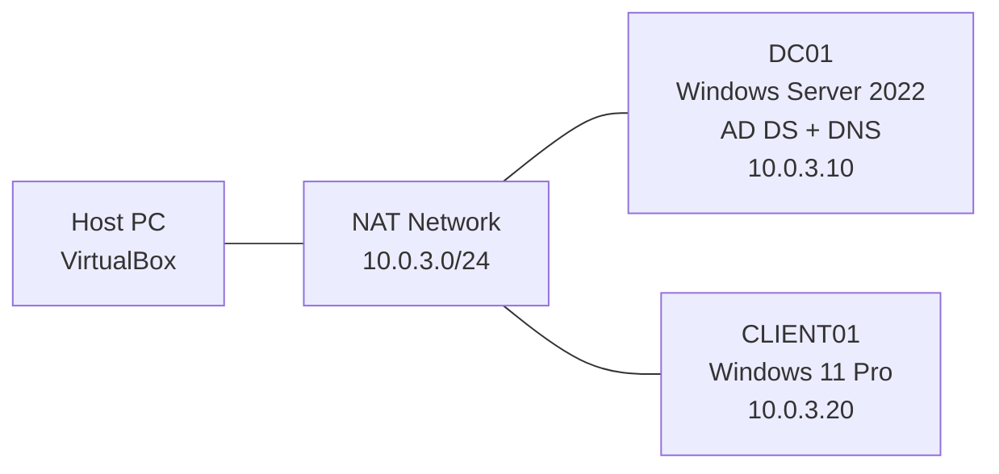

## Setup

### 1. Domain controller
Installed Windows Server 2022, set a static IP, and promoted it to a domain controller in a new forest (AD DS + DNS). The server first picked up a DHCP address, then I switched it to a static one, since the domain controller is also the DNS server and clients need a fixed address to find it.

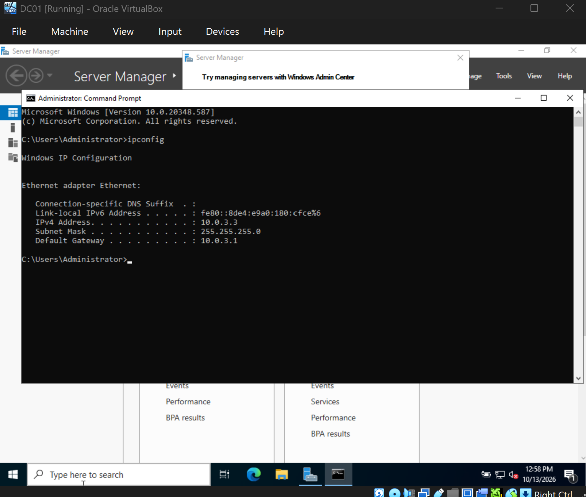
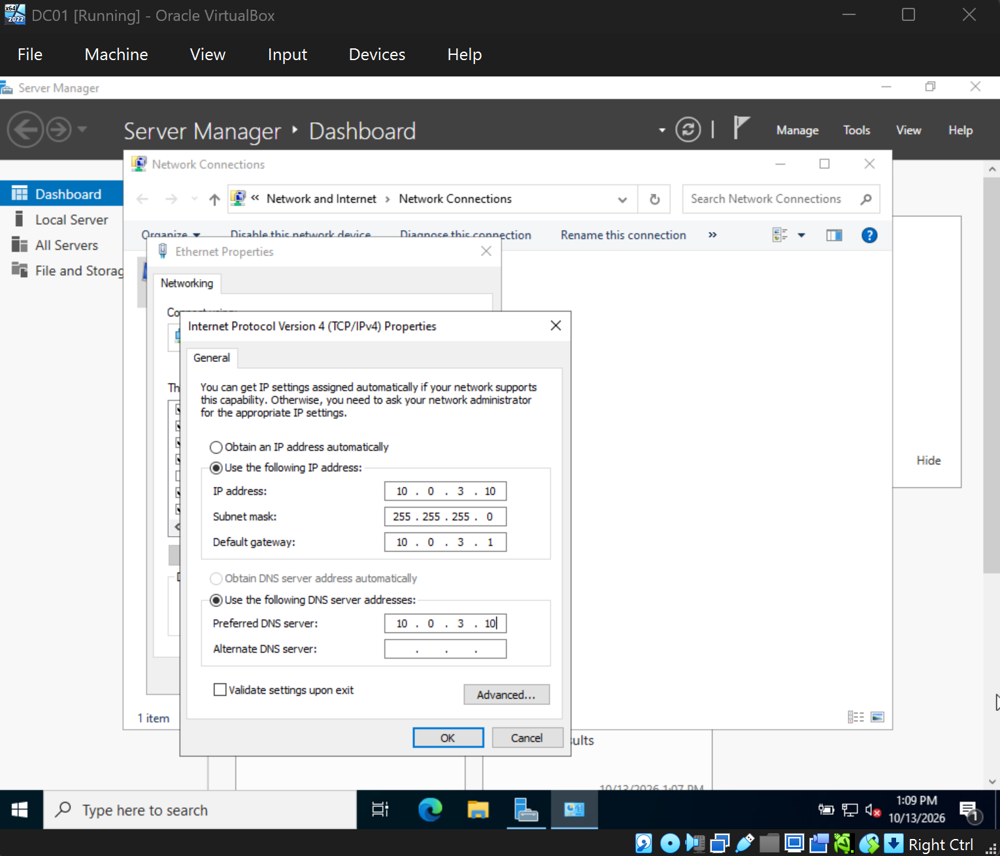

### 2. Joining a client
Joined a Windows 11 Pro client to the domain and moved it into a `Workstations` OU. Windows 11 Home can't join a domain, so the client needs the Pro edition.

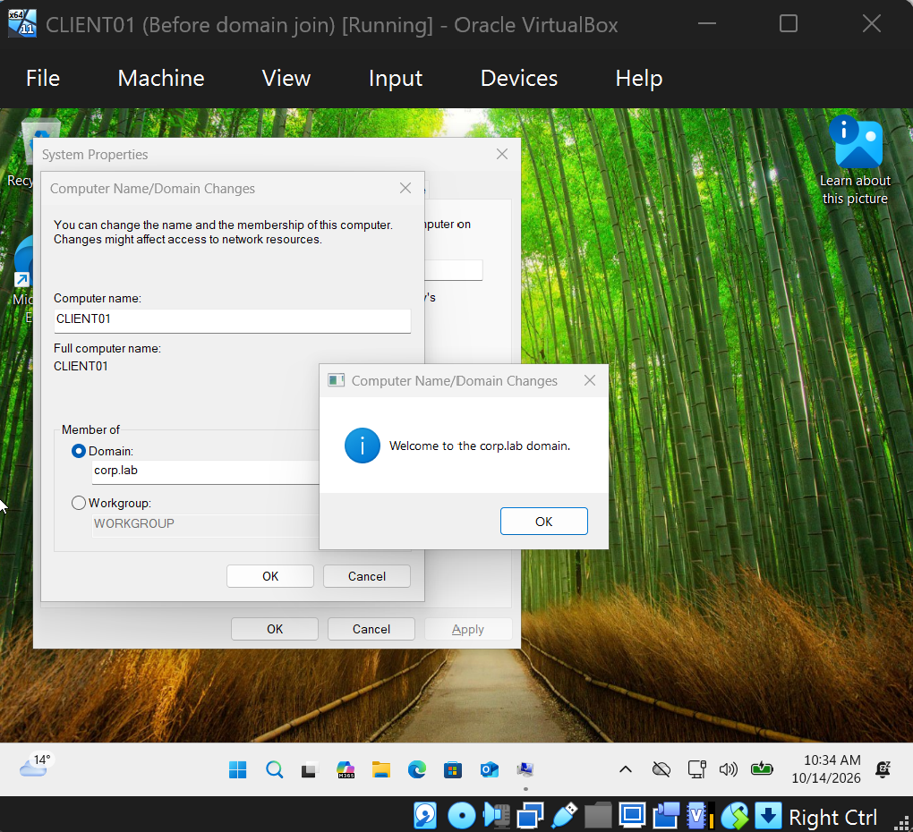
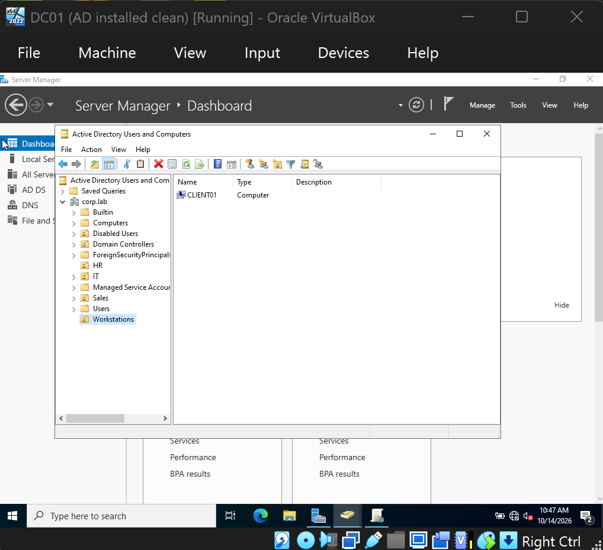

### 3. Users, groups and OUs
- OUs: Sales, IT, HR, Disabled Users, Workstations
- User accounts across the OUs and an `IT-Helpdesk` security group
- Practiced help desk tasks: password resets, account unlock and disable, moving users between OUs, group membership changes

## Group Policy

### Restrict Control Panel (linked to the IT OU)
Blocks access to Control Panel and PC settings for users in the IT OU.

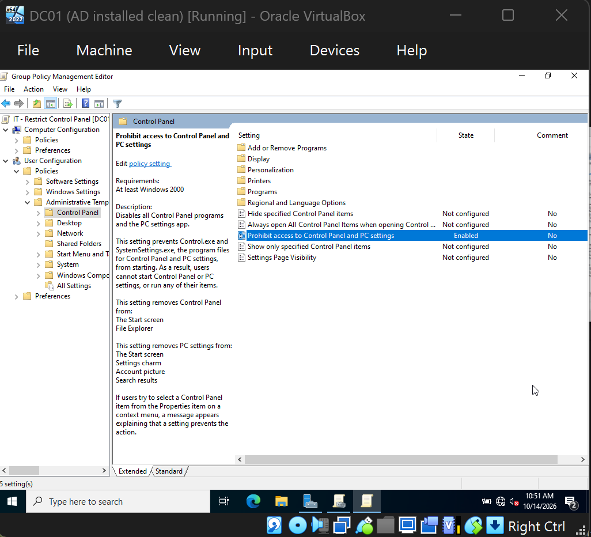

- **Test:** signed in as `CORP\bwilson` on CLIENT01 and was blocked with "This operation has been cancelled due to restrictions in effect on this computer."
- **Verification:** `gpresult /r` listed the policy under Applied Group Policy Objects, applied from DC01.corp.lab.

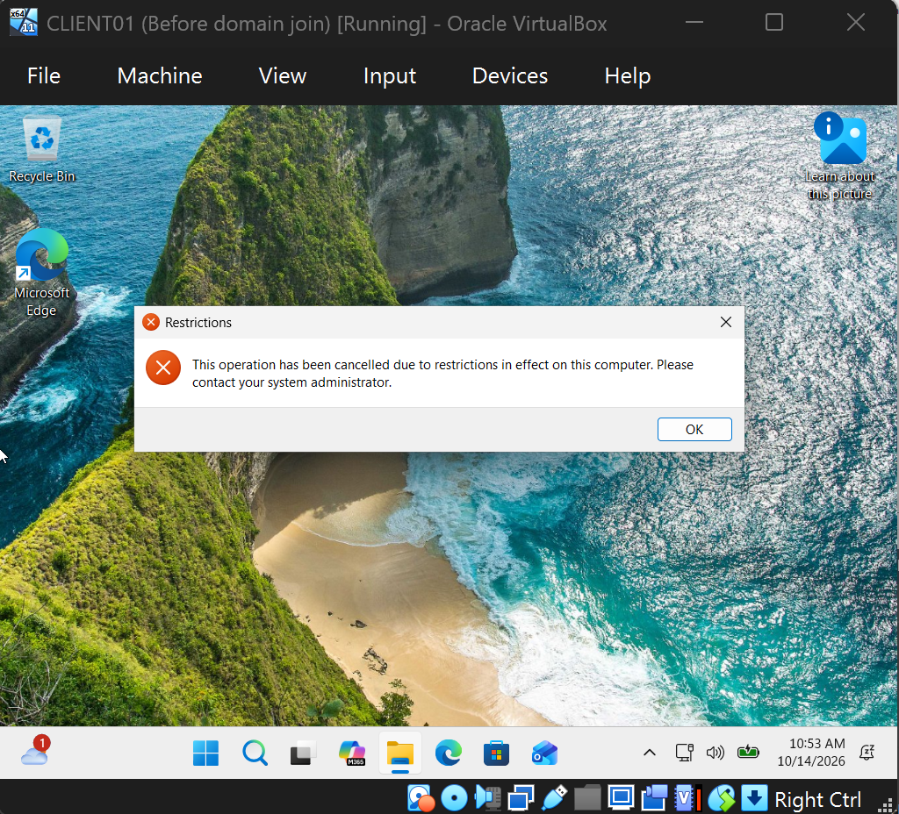
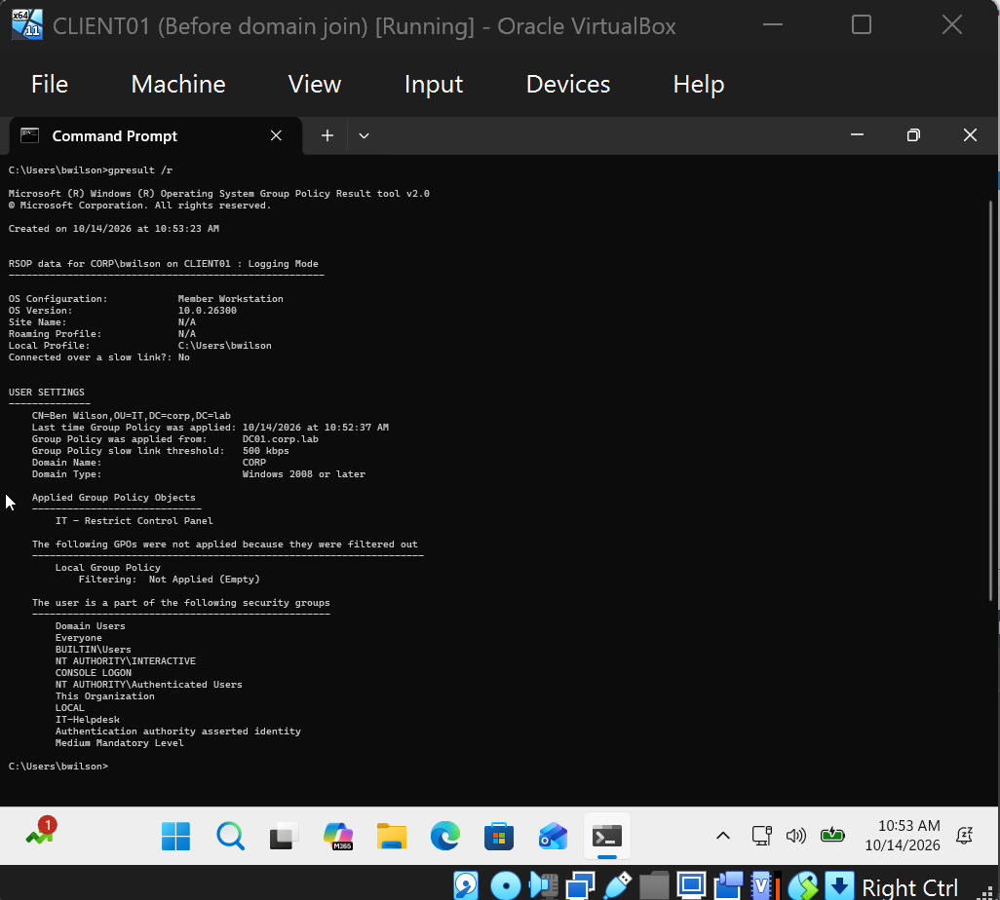

### Account lockout policy (Default Domain Policy)
3 invalid attempts, 30-minute lockout duration, 30-minute counter reset.

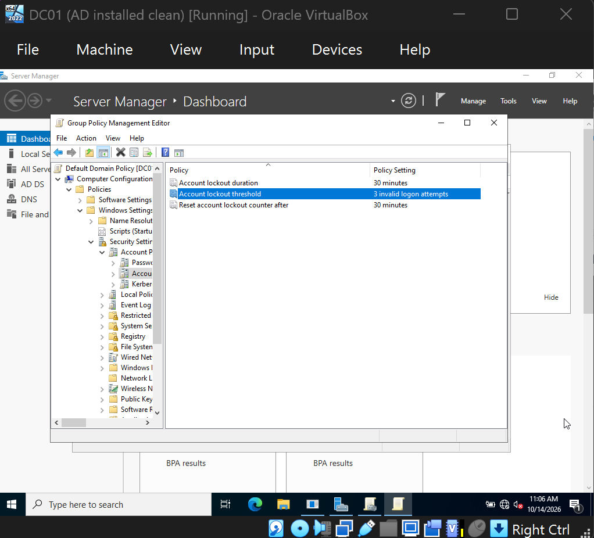

## Troubleshooting scenario: locked-out user (simulated)

- **Report:** "I can't sign in to my computer."
- **Environment:** CLIENT01 (Windows 11 Pro), domain corp.lab, DC01
- **Symptoms:** The sign-in screen showed "The referenced account is currently locked out and may not be logged on to." Entering the correct password didn't help.
- **Diagnosis:** Opened Active Directory Users and Computers on DC01, found the user (`bwilson`), and checked the Account tab of the user's Properties, which reported the account as locked out.
- **Root cause:** Three failed sign-in attempts met the lockout threshold I set in the Default Domain Policy.
- **Resolution:** Ticked "Unlock account" on the Account tab.
- **Verification:** The user signed in successfully on CLIENT01.
- **Notes:** In a real environment I'd also check for stale saved passwords (phones, mapped drives) that cause repeated lockouts, and confirm the user's identity before unlocking.

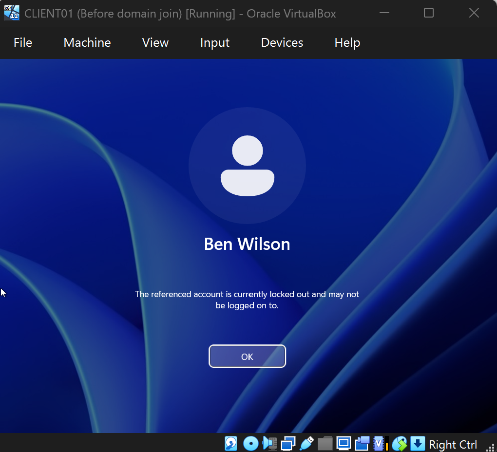
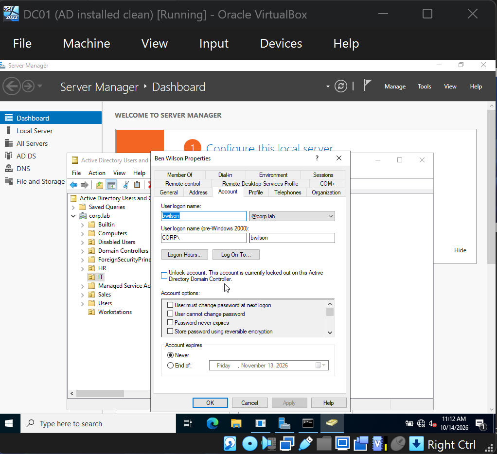
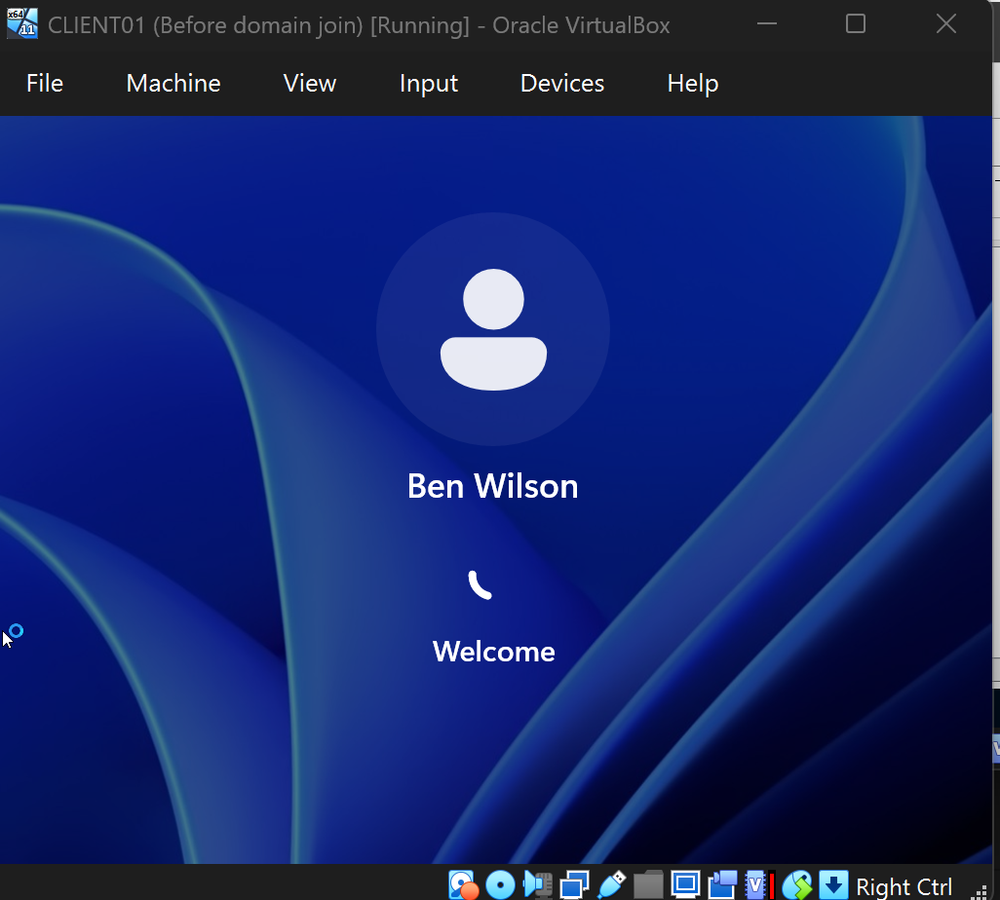

## Troubleshooting log (lab build)

| Problem | Cause | Fix |
|---|---|---|
| VirtualBox error "VERR_PATH_NOT_FOUND" starting the server VM | Unattended-install files pointed to a folder from the VM's old name | Removed the stale disc from Storage settings, recreated the VM with unattended install off |
| Windows Server setup restarted after finishing the first stage | Pressed a key at "Press any key to boot from CD or DVD" and booted the installer again | Removed the ISO from the virtual drive and booted from the hard disk |
| Windows 11 VM stuck on a black screen, green turtle icon | VirtualBox was running on top of Windows' own virtualization layer (Hyper-V features) | Turned off Hyper-V, Virtual Machine Platform, Windows Hypervisor Platform and Memory integrity, restarted, recreated the VM |

## What I'd add next
- Shared folder with group-based permissions
- Bulk user creation with PowerShell
- A second GPO tied to the Workstations OU

Part of my portfolio: [thushar003.github.io](https://thushar003.github.io/)
